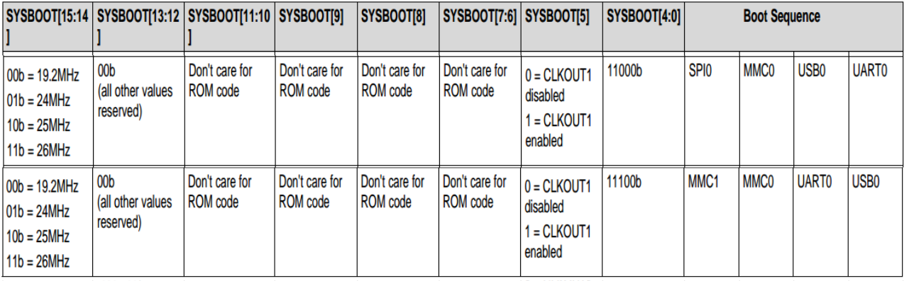
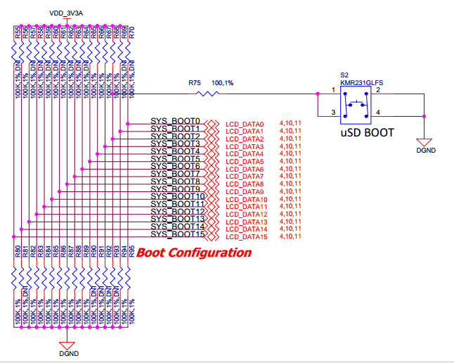
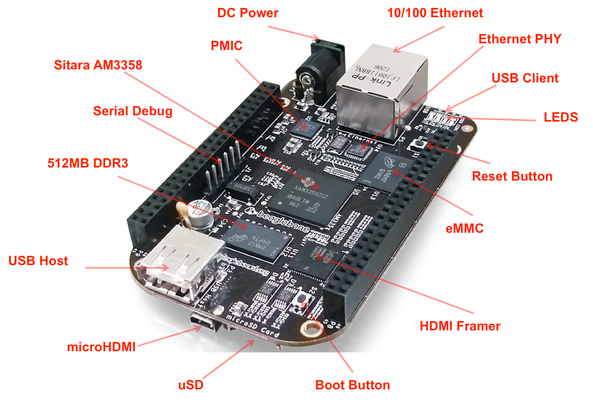
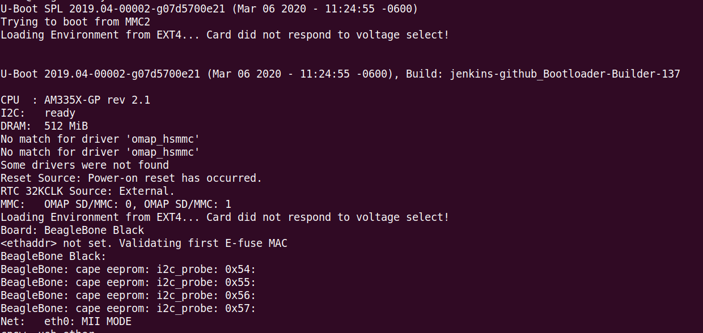
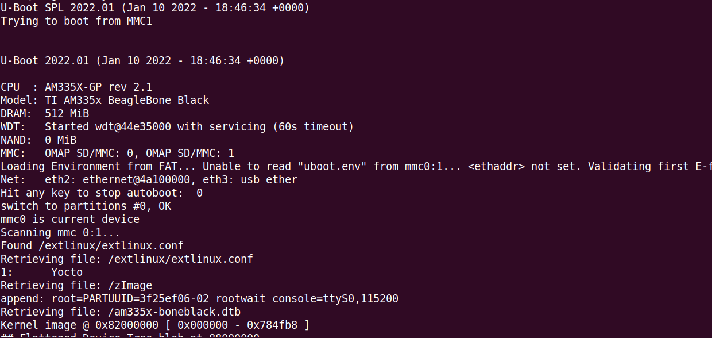

# Linux Boot Process — Part 2: How Does Boot ROM Know Which Device to Boot From?

You press the power button on a BeagleBone Black.

Before SPL runs.

Before U-Boot runs.

Before Linux starts.

The AM3358 Boot ROM has to answer one fundamental question:

**Which device should I boot from?**

eMMC?

microSD?

USB?

UART?

The answer comes from the **boot configuration pins**.

## Step 1: The AM3358 samples SYSBOOT[4:0]

When the AM3358 comes out of reset, the Boot ROM samples the state of the **SYSBOOT[4:0] pins**.

These tell the Boot ROM which boot configuration has been selected and what boot sequence to follow.

The Technical Reference Manual (Table 26-7. SYSBOOT Configuration Pins[4]) defines the relationship between the SYSBOOT pin values and the boot configuration.

*AM3358 TRM showing SYSBOOT[4:0] boot configuration / boot device selection*


Conceptually:

```text
Power ON / Reset
       │
       ▼
AM3358 Boot ROM starts
       │
       ▼
Sample SYSBOOT[4:0]
       │
       ▼
Decode boot configuration
       │
       ▼
Select boot device / boot mode
       │
       ▼
Try to load the first boot image
```

So Boot ROM does not randomly search every device on the board.

**The boot configuration tells it where and how to start looking.**

---

## Step 2: How are these pins configured on the BeagleBone Black?

The AM3358 is only the SoC.

The actual logic levels on SYSBOOT[4:0] are determined by how the **BeagleBone Black hardware connects these pins**.

This is where the BBB schematic becomes important.



The schematic shows how the board hardware establishes the boot configuration seen by the AM3358.

This is an important BSP concept:

**The Boot ROM is inside the SoC, but the boot mode is influenced by the board hardware.**

The software engineer debugging a boot issue therefore cannot always look at software alone.

Sometimes the answer is in the schematic.

---

## Step 3: What happens on the BeagleBone Black?

The BBB has multiple possible boot interfaces, including:

* Onboard eMMC
* microSD
* USB
* UART

Under its normal boot configuration, the board follows its configured boot path. 

On boot, the processor will look for the eMMC on the MMC1 port first, followed by the microSD slot on MMC0, USB0 and UART0.In the event there is no microSD card and the eMMC is empty, UART0 or USB0 could be used as the board source.

The **BOOT button** changes the relevant boot configuration during power-up, allowing the board to use the microSD boot path.

*BeagleBone Black board image showing and labeling: BOOT button, onboard eMMC, and microSD slot*


Hold the boot button down. On boot, the processor will look for the SPIO0 port first, then microSD on the MMC0 port, followed by USB0 and UART0. In the event there is no microSD card and the eMMC is empty, USB0 or UART0 could be used as the board source.

So the sequence is:

```text
                 POWER ON
                     │
                     ▼
              AM3358 Boot ROM
                     │
                     ▼
              Sample SYSBOOT pins
                     │
                     ▼
          Read hardware boot configuration
                     │
             ┌───────┴────────┐
             │                │
       Normal configuration   BOOT button held
             │                │
             ▼                ▼
   MMC1/MMC0/USB0/UART0     SPI0/MMC0/USB0/UART0
             
             │                │
             └────────┬───────┘
                      ▼
          Boot ROM accesses boot device
                      │
                      ▼
          Find/load first-stage image
                      │
                      ▼
                  MLO / SPL
```

---

## Can we actually see Boot ROM selecting the device in the serial log?

This is where early boot debugging becomes interesting.

**Boot ROM executes before SPL and U-Boot.**

So we don't normally get a friendly UART message saying:

```text
Boot ROM: SYSBOOT = xxxx
Boot ROM: Selected eMMC
Boot ROM: Loading MLO...
```

Instead, we observe the result of a successful handoff.

For example, I can boot the BBB through different boot configurations and capture the serial output.

*Terminal log showing normal boot path*


*Terminal log showing microSD boot path with BOOT button held*


The first visible messages come only after the next boot stage has started executing.

That gives us an important debugging principle:

> **A missing U-Boot log does not necessarily mean U-Boot is broken. U-Boot may never have been reached.**

The failure may have happened earlier:

```text
Power ON
   │
   ▼
Boot ROM
   │
   ├── Sample SYSBOOT pins
   │
   ├── Select boot configuration
   │
   ├── Access boot device
   │
   └── Load first-stage image
            │
            ▼
          MLO/SPL
            │
            ▼
          U-Boot
            │
            ▼
        UART output
```

If the Boot ROM cannot successfully complete the handoff to the next stage, you may never see the U-Boot logs you were expecting.

That is why, when debugging a board that does not boot, the first question should be:

**How far did execution actually get?**

Not:

**Which software component should I blame first?**

---

In the next post:

**Linux Boot Process — Part 3: What Exactly Does SPL Do?**

We'll look at what happens after Boot ROM loads the first-stage image and why SPL is responsible for bridging the gap between the limited early hardware environment and full U-Boot.
